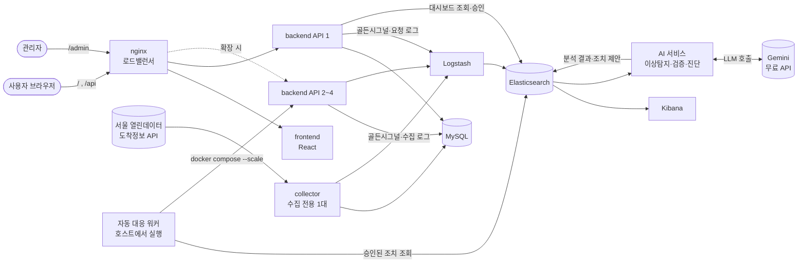
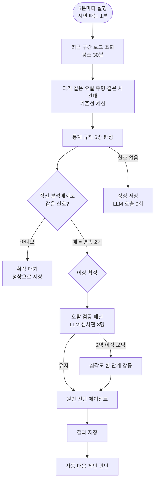
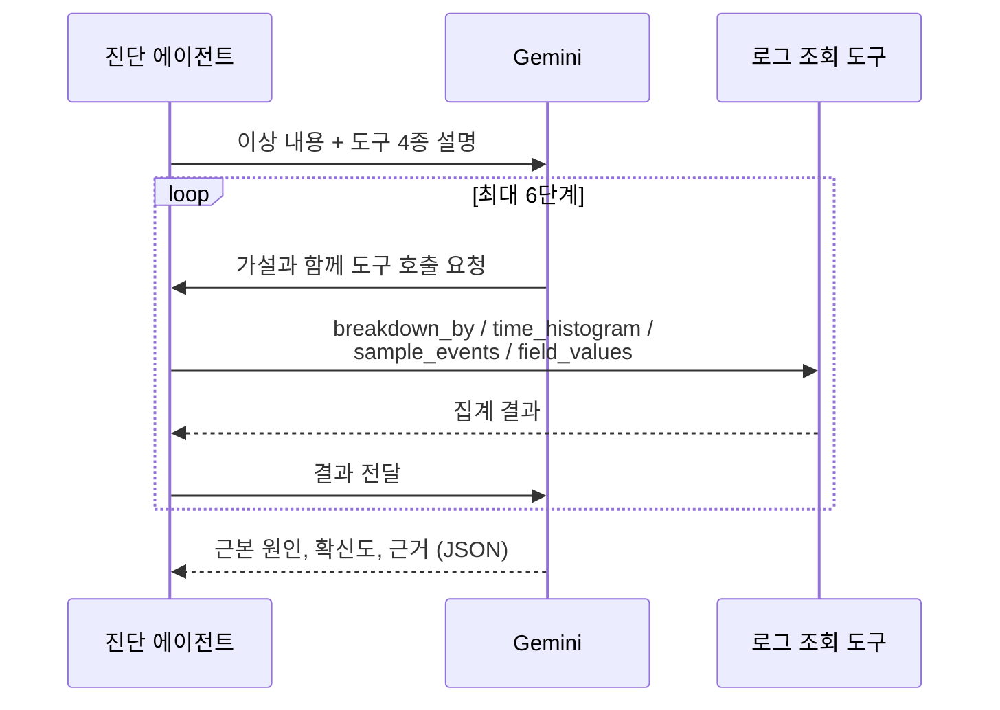
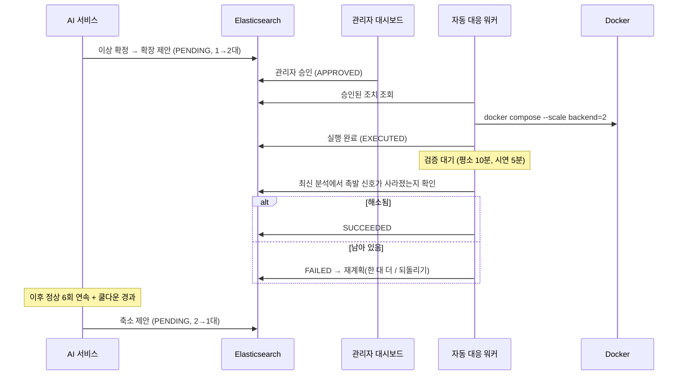
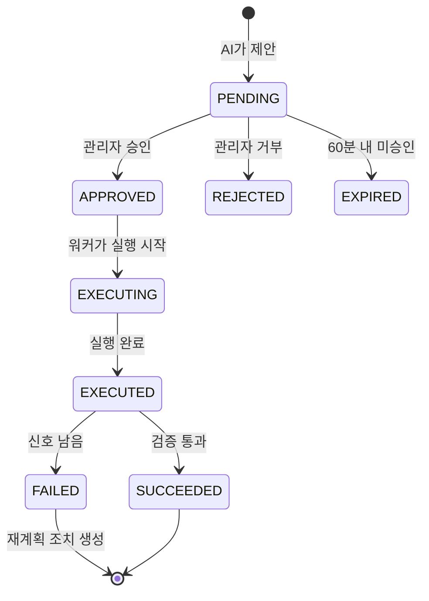

# 기능 설명서

서울 지하철 1호선 실시간 도착정보 서비스와, 그 서비스를 스스로 지켜보는 AI 관제 시스템입니다.
사용자는 도착정보를 보고, 시스템은 자기 로그를 분석해 이상을 찾아내고, 원인을 조사하고,
관리자 승인을 받아 서버를 늘리거나 줄인 뒤 효과가 있었는지까지 확인합니다.

## 1. 전체 구조



| 구성 요소 | 역할 |
|---|---|
| frontend | 사용자 화면(역 검색·도착정보·즐겨찾기)과 관리자 대시보드 |
| backend (API) | REST API, 인증, 요청마다 지표 집계. 확장 대상 |
| collector | 서울 API에서 도착정보를 30초마다 수집. 중복 수집을 막기 위해 반드시 1대 |
| nginx (lb) | 프론트엔드와 API를 한 주소로 묶고 API 서버들에 요청을 나눔 |
| ELK | 모든 로그를 모아 검색·시각화. AI 분석의 데이터 원천 |
| AI 서비스 | 주기적으로 로그를 분석해 이상 판정, LLM 검증·진단, 조치 제안 |
| 자동 대응 워커 | 관리자가 승인한 조치를 실제로 실행하고 효과를 검증 |

## 2. 사용자 기능

| 기능 | 내용 | API |
|---|---|---|
| 역 검색 | 이름으로 1호선 역 검색 | `GET /api/v1/stations/search` |
| 실시간 도착정보 | 역별 상·하행 도착 예정 열차, 전체 역 현황 | `GET /api/v1/stations/{id}/arrivals`, `/arrivals/all` |
| 노선도 | 1호선 노선과 열차 위치 | 프론트엔드 `RouteMap` |
| 회원가입·로그인 | 이메일 로그인, Google 로그인 | `/api/v1/auth/register`, `/login`, `/google` |
| 즐겨찾기 | 자주 가는 역 저장 | `/api/v1/users/me/favorites` |
| 이용 패턴 | 내가 자주 보는 역·시간대 | `/api/v1/users/me/station-patterns` |
| 도착 알림 | 즐겨찾기 역에 열차가 곧 도착하면 화면 알림 | `/api/v1/users/me/arrival-alerts` |

수집은 운영 종료 시간(01:00~05:30)에는 멈춥니다. 수집 프로세스를 1대로 고정한 이유는 여러 대가
동시에 수집하면 외부 API 하루 한도를 대수만큼 빨리 소진하고, 서로 방금 저장한 데이터를 지우기 때문입니다.

## 3. 관측 — 무엇을 모으는가

모든 API 인스턴스는 60초마다 **골든시그널 요약**(요청 수, 초당 요청, 응답시간, CPU·메모리, 대기 요청 수,
인스턴스 ID)을 로그로 남깁니다. 수집기는 서울 API 호출 결과와 수집량을, 스케줄러는 실행 성공 여부를 남깁니다.
이 로그가 Logstash를 거쳐 Elasticsearch에 쌓이고, AI 분석과 Kibana가 모두 이 데이터를 씁니다.

실제 사용자가 없는 환경에서도 기준 데이터를 만들기 위해 **트래픽 시뮬레이터**가 실제 API를 시간대별 강도로
호출하고, 평균 8시간마다 5~12분간 요청을 10배로 늘리는 급증을 스스로 섞습니다.

## 4. AI 이상탐지 — 한 번의 분석이 진행되는 순서



### 4.1 통계 규칙

판정은 LLM이 아니라 통계가 합니다. LLM은 판정을 올릴 수 없고, 검증 패널을 통해 한 단계 낮추기만 합니다.

| 신호 | 판정 방식 | 기본 기준 | 새벽 평가 |
|---|---|---|---|
| 트래픽 급증 (traffic) | 기준선 대비 배수 + z-score 게이트 + 절대 상한 | 2배 이상 & z≥2, 또는 20/50 req/s | 평가 |
| 자원 포화 (saturation) | 절대 기준 | CPU·메모리 60%(주의) / 80%(위험) | 평가 |
| 응답시간 (latency) | 기준선 대비 배수 + z 게이트 | 1.5배(주의) / 2배(위험) | 제외 |
| 외부 API 오류 (api_errors) | 절대 기준 | 오류율 5% / 20% | 제외 |
| 스케줄러 실패 (scheduler) | 실패 발생 | — | 제외 |
| 수집량 급감 (collection) | 기준선 대비 | 50% 이하 | 제외 |

- **기준선**: 과거 같은 시간대·같은 평일/주말 표본으로 평균·표준편차·분위수를 계산합니다. 표본이 5건 미만이면 비교하지 않습니다.
- **연속 감지**: 한 번 튄 값으로 알람이 울리지 않도록 2회 연속 감지되어야 확정합니다.
- **정상이면 LLM을 부르지 않습니다.** 그래서 5분마다 분석해도 정상인 시간에는 비용이 0입니다.

### 4.2 오탐 검증 패널

같은 데이터를 세 관점의 LLM 심사관이 서로의 답을 보지 않고 각자 판단합니다.

| 심사관 | 의심하는 것 |
|---|---|
| 배포/재시작 회의론자 | 재시작·배포·확장 직후의 일시적 현상 아닌가 |
| 지속성 심사관 | 잠깐 튀고 끝난 것 아닌가 |
| 근거 심사관 | 비교 근거(표본 수, 분모)가 충분한가 |

2명 이상이 오탐이라고 하면 심각도를 한 단계 낮춥니다. 오탐으로 볼 수 있는 이유는 프롬프트에서 제한합니다
(서버 1대, 충분한 표본, 낮은 CPU는 오탐 근거가 될 수 없음). 평가 셋 13케이스에서 판정 정확도 11/11, 심사관 일치율 39/39입니다.

### 4.3 원인 진단 에이전트

통계는 "무엇이 이상한가"까지만 압니다. "왜"는 LLM이 로그 조회 도구를 직접 골라 쓰며 조사합니다.



| 도구 | 하는 일 |
|---|---|
| breakdown_by | 엔드포인트·오류코드·인스턴스 등 필드별 집계 |
| time_histogram | 5분 단위 시간 추이 |
| sample_events | 조건에 맞는 로그 원문 샘플 |
| field_values | 특정 필드의 값 분포 |

도구 결과에 없는 숫자나 원인은 쓰지 못하게 하고, 6단계 안에 못 찾으면 "미결"로 끝냅니다.
진단은 설명용이며 판정과 대응을 바꾸지 않습니다.

## 5. 자동 대응 — 감지에서 검증까지

트래픽·포화·응답시간처럼 **서버를 늘려서 해결되는 신호**만 대상으로 합니다.
외부 API 장애나 스케줄러 실패는 서버를 늘려도 소용없으므로 제안하지 않습니다.





### 5.1 안전장치

| 장치 | 기본값 | 이유 |
|---|---|---|
| 관리자 승인 | 필수 | 인프라 변경은 사람이 결정 |
| 권한 분리 | — | AI는 제안만, 백엔드는 상태 변경만, 실제 실행은 호스트 워커만 |
| 최대 대수 | 4대 | 오탐 한 번이 무한 확장으로 이어지지 않게 |
| 쿨다운 | 15분 | 확장 직후 지표가 안정될 시간 |
| 중복 제안 방지 | — | 처리 안 된 제안이 있으면 새로 만들지 않음 |
| 제안 만료 | 60분 | 오래된 제안이 뒤늦게 실행되지 않게 |
| 롤백의 롤백 금지 | — | 확장·축소 무한 왕복 방지 |
| 재계획 | — | 검증 실패 시 진단이 "서버로 해결 안 되는 원인"을 지목하면 되돌리고, 아니면 한 대 더 |

## 6. 관리자 대시보드

| 화면 | 내용 | API |
|---|---|---|
| 상태 요약 | 현재 정상/주의/위험, 오늘 이상 건수 | `/api/v1/admin/summary`, `/status` |
| 이상 내역·인사이트 | 감지 신호, 근거, 지표 추이, 권장 조치 | `/anomalies`, `/insights` |
| 검증 패널 | 심사관 3명의 판정과 이유 | `/verification` |
| 진단 타임라인 | 진단 에이전트가 어떤 도구를 왜 불렀고 무엇을 봤는지 | `/diagnosis` |
| 자동 대응 | 제안 목록, 승인·거부 버튼, 실행·검증 결과 | `/remediation`, `/remediation/{id}/approve`, `/reject` |

## 7. 운영·배포

| 항목 | 내용 |
|---|---|
| 기본 구성 | `docker compose up -d` — backend 1대가 API와 수집을 모두 담당 |
| 확장 구성 | `docker-compose.scale.yml` — API(N대)·collector(1대)·nginx로 분리 |
| 시연 구성 | `docker-compose.demo.yml` + `scripts/demo.sh` — 분석 1분 주기 (README "시연" 절) |
| 비밀값 | DB 비밀번호·API 키는 `.env`에서만 읽음 (`.env.example` 참고) |
| CI | 푸시마다 백엔드 테스트(MySQL), AI 서비스 테스트, 프론트 타입검사·빌드, compose 검증, 확장 토폴로지 검사, 이미지 빌드 |
| CD | 버전 태그를 붙이면 GHCR에 이미지 게시 (linux/amd64) |
| 백업 | 매일 새벽 2시 Elasticsearch 스냅샷 (launchd) |
| LLM | Gemini 무료 API (OpenAI 호환 방식, 환경변수 3개로 공급자 교체). 429 응답은 분당 제한이면 대기 후 재시도, 하루 한도면 즉시 포기 |

## 8. 시연 진행

```bash
scripts/demo.sh up        # 시연 모드: 1분 분석, 이전 조치 정리, 워커·시뮬레이터 시작
scripts/demo.sh spike 8   # 실제 백엔드에 약 10배 요청을 8분간
scripts/demo.sh status    # 서버 대수, 최근 분석, 최근 조치
scripts/demo.sh normal    # 평소 모드(5분, 1대)로 복귀
```

시연 모드는 분석 1분 주기, 분석 구간 5분, 확장 후 5분 뒤 검증, 쿨다운 5분입니다.

리허설 실측:

| 단계 | 1차 (10/13) | 3차 (10/14) |
|---|---|---|
| 급증 시작 → 첫 감지 | 3분 43초 | 2분 52초 |
| → 이상 확정·검증·진단·확장 제안 | 5분 25초 | 4분 12초 |
| 승인 → 2대로 확장 | 7초 | 4초 |
| 확장 → 검증 | 3분 뒤 성공 | 3분 뒤 실패(급증 진행 중) → 재계획 제안 거부 |
| 정상 지속 → 축소 제안(2→1) | — | 정상 7회 뒤 |
| 승인 → 1대로 축소 → 검증 | — | 5초, 3분 뒤 성공 |

3차에서 확장 3분 뒤 검증은 급증이 아직 끝나기 전이라 실패로 판정됐고, 이후 시연용 검증 대기를 5분으로 늘렸습니다.

## 9. 알려진 한계

- 상시 서버가 없어 노트북이 켜져 있을 때만 관측합니다(외부 서버 구동은 11월 예정).
- 평소 분석 구간(30분)에서는 새벽처럼 요청이 적은 시간대의 짧은 급증이 평균에 묻혀 놓치는 경우가 있습니다.
- 알림은 앱 화면 안에서만 보여줍니다(푸시·이메일 없음).
- Google 로그인은 등록된 주소에서만 동작해, 임시 터널 주소에서는 이메일 로그인만 시연합니다.
- Elasticsearch·Kibana는 인증 없이 로컬(127.0.0.1)에만 열려 있습니다.
- 프론트엔드 자동 테스트와 DB 마이그레이션 도구는 없습니다.
